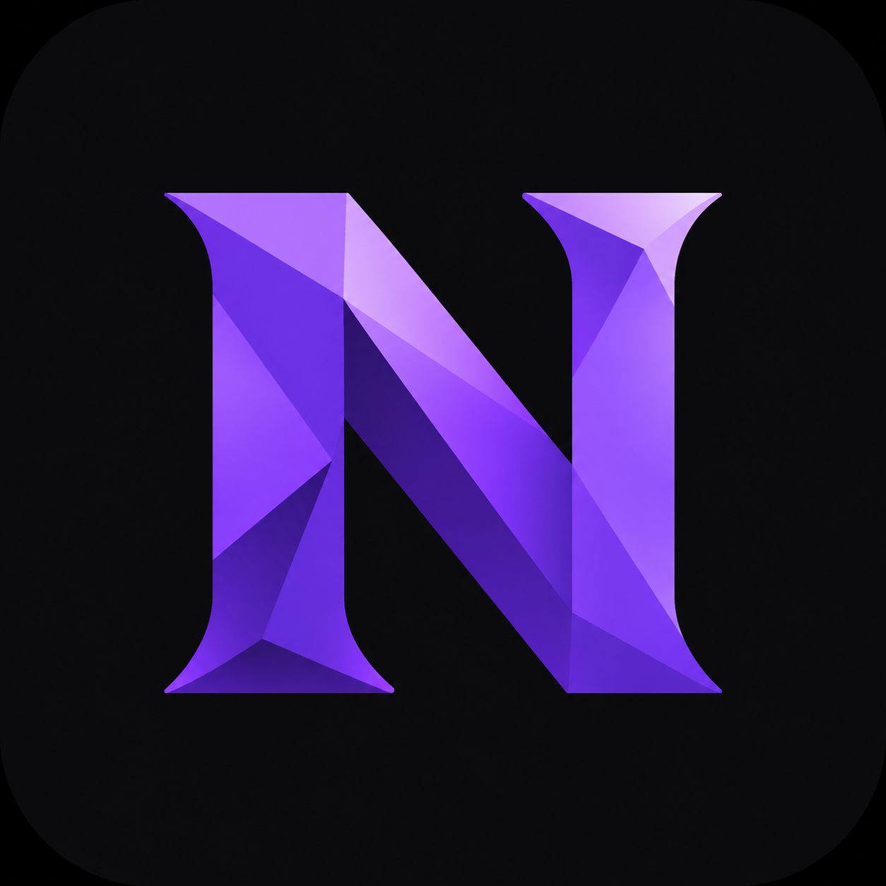
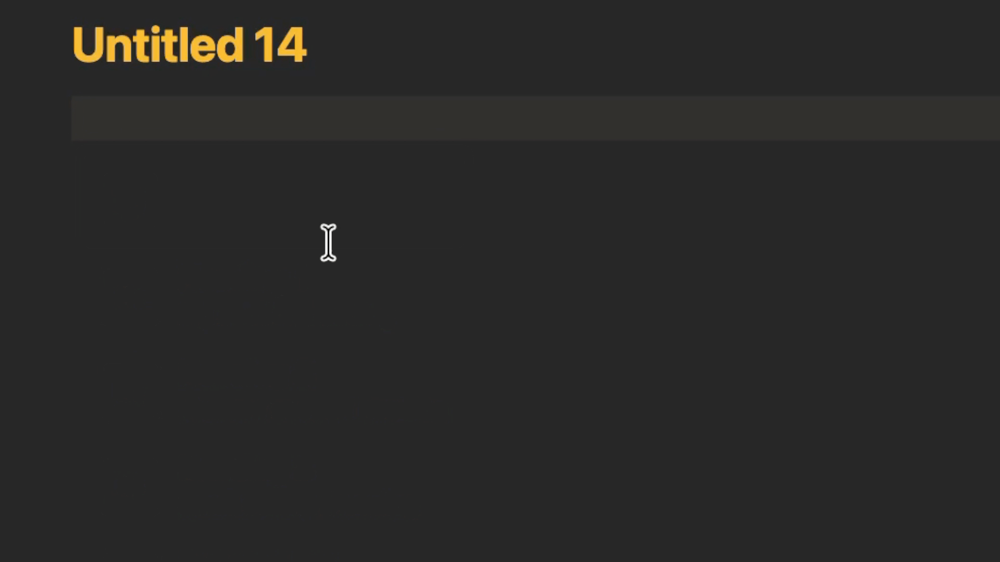

<p align="center">
  
</p>

<h1 align="center">Notionize</h1>

<p align="center">
  Write in Obsidian the way you write in Notion. Your notes stay plain Markdown.
</p>

<p align="center">
  <a href="https://github.com/AvzLucas/notionize/actions/workflows/ci.yml"></a>
  <a href="https://github.com/AvzLucas/notionize/releases/latest"></a>
  <a href="LICENSE"></a>
  
</p>



## Why

Many of us moved from Notion to Obsidian for local, file-based notes, but still miss how easy Notion feels to write in: a slash menu, blocks you can drag around, and no md syntax.

Notionize brings that editing experience to Obsidian without changing the final content of your files. Every block is written as standard Markdown, and if you disable the plugin your notes look exactly as they did before.

## Features

### Slash menu

Type `/` on an empty line and keep typing to filter. Pick with the arrow keys and Enter.

| Block | Aliases | What it writes |
| --- | --- | --- |
| To-do list | `todo`, `task`, `checkbox` | `- [ ] ` |
| Heading 1, 2, 3 | `h1`, `h2`, `h3` | `#`, `##`, `###` |
| Bulleted list | `bullet`, `ul` | `- ` |
| Numbered list | `numbered`, `ol` | `1. ` |
| Toggle list | `toggle`, `fold`, `dropdown` | `+ ` with children indented below |
| Quote | `quote` | `> ` |
| Callout | `callout`, `info`, `note` | `> [!note]` |
| Code | `code`, `snippet` | a fenced code block |
| Divider | `divider`, `hr`, `line` | `---` |
| Table view | `table`, `database` | an Obsidian Bases `base` block |
| Card view | `cards`, `gallery`, `board` | an Obsidian Bases `base` block |

Table and card views list the notes of a folder you choose, using Obsidian's built-in Bases (Obsidian 1.9 or newer).

### Drag handles

Hover a block to reveal its handle.

- **Drag** it to move the block together with everything nested under it. A ghost preview follows the pointer and a line shows where it will land.
- **Drop on the lower half of a toggle's title** to nest the block inside that toggle.
- **Click** it for the block menu: delete, duplicate, or turn the block into another type.

### Markdown stays out of sight

In Live Preview, the syntax of the block you are editing is hidden: `## `, `> `, `- [ ] `, `> [!note]` and code fences disappear, and only the content remains.

- To-dos show a real, clickable checkbox.
- Callouts are styled like the rendered callout while you type, with the right colour and icon for each type.
- Code blocks show a language label instead of fences.

### Toggles

A toggle is a plain `+` list item with its children indented underneath. Click the triangle to fold or unfold it. Fold state lives in Obsidian and is never written to your file. Press Enter at the end of an open toggle's title to start its first child.


## Installation

### From the community directory

Once Notionize is approved: **Settings → Community plugins → Browse**, search for **Notionize**, then install and enable it.

### Manual installation

1. Download `main.js`, `manifest.json` and `styles.css` from the [latest release](https://github.com/AvzLucas/notionize/releases/latest).
2. Create the folder `.obsidian/plugins/notionize` inside your vault and copy the three files into it.
3. In Obsidian, open **Settings → Community plugins**, enable community plugins if needed, and turn on **Notionize**.

### Requirements

- Obsidian 1.9.0 or newer.
- Live Preview mode. In Source mode the Markdown stays visible, by design.

## Usage

1. Open a note in Live Preview.
2. On an empty line, type `/` and choose a block.
3. Hover a block and use its handle to move it or open its menu.

## Development

```bash
git clone https://github.com/AvzLucas/notionize.git
cd notionize
npm install
npm test
```

| Command | What it does |
| --- | --- |
| `npm run dev` | Rebuilds `main.js` on every change |
| `npm run build` | Type-checks and builds the production `main.js` |
| `npm run deploy` | Builds, then copies the plugin into your vault |
| `npm test` | Runs the tests in watch mode |
| `npm run test:run` | Runs the tests once, as CI does |

To use `npm run deploy`, copy `.env.example` to `.env` and set `OBSIDIAN_PLUGIN_DIR` to `/path/to/your/vault/.obsidian/plugins/notionize`. Then reload the plugin in Obsidian.

### How it is organised

The code is split so that the logic can be tested without Obsidian.

| Folder | Role |
| --- | --- |
| `src/core/blocks` | Pure TypeScript. Parses a document into a block tree: nesting, multi-line callouts, quotes and tables, code fences and front matter. |
| `src/core/ops` | Pure TypeScript. Every document edit as a function from text to text: move, backspace, delete, duplicate, convert, insert templates. |
| `src/editor` | CodeMirror 6 extensions: hidden syntax, widgets, toggles and folding, key handling and drag handles. |
| `src/features` | The Obsidian layer: the slash menu and the block menu. |

### Tests and CI

The core is covered by Vitest unit tests that run against plain strings, with no Obsidian or DOM needed. GitHub Actions runs the build and the tests on every pull request and on every push to `main`.

### Releasing

1. Bump `version` in `manifest.json` and `package.json`, and add the version with its `minAppVersion` to `versions.json`.
2. Commit and push to `main`.
3. Push a tag with exactly the same version, for example `git tag 0.2.0 && git push origin 0.2.0`.

The release workflow runs the build and tests, checks that the tag matches the manifest version, and publishes a GitHub release with `main.js`, `manifest.json` and `styles.css` attached.

## Roadmap

- [ ] Optional Notion-style template, enabled from settings
- [ ] Columns
- [ ] Richer database views

## Contributing

Issues and pull requests are welcome. Please run `npm run build` and `npm run test:run` before opening a pull request, and add tests for any change in `src/core`.

## License

[MIT](LICENSE) © Lucas Vallerius
