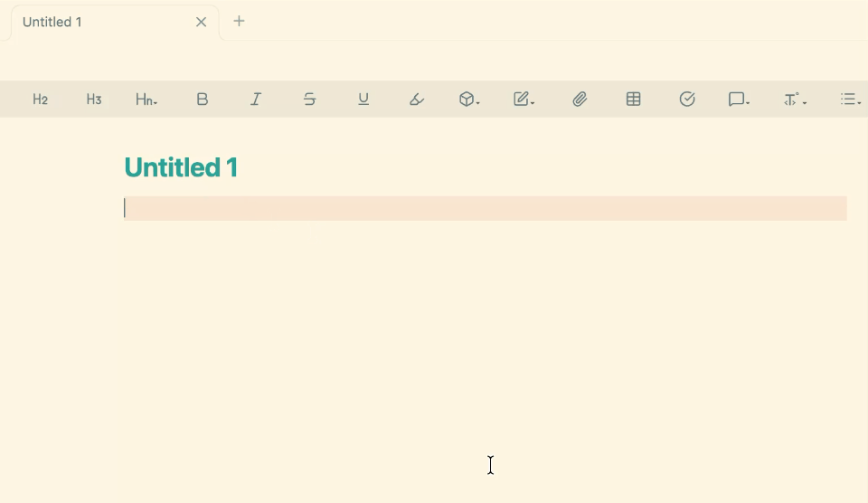

# Notionize
- An Obsidian Plugin for Notion lovers.

> Early MVP — more features will be available soon

## About
Many of us moved to Obsidian from Notion for local note-taking, but miss how easy Notion feels to write in. Notionize brings some of that experience to Obsidian while keeping your notes as normal Markdown files.

## Current features

- Type `/` on a new empty line to open the suggestion menu and create To-do, Quote, Callout, Code, and Heading blocks.

## Installation

### Manual installation

1. Download `main.js`, `manifest.json`, and `styles.css` from the latest GitHub Release. If no release is available yet, use the clone instructions below.
2. Create this folder in your vault:

   `.obsidian/plugins/notionize`

3. Copy those files into that folder.
4. In Obsidian, enable **Community plugins** and turn on **Notionize**.

### Install by cloning this repo

1. Clone the repository and install dependencies:

   ```bash
   git clone https://github.com/AvzLucas/notionize.git
   cd notionize
   npm install
   ```

2. Create your local configuration file:

   ```bash
   cp .env_interface .env
   ```

3. In `.env`, set `OBSIDIAN_PLUGIN_DIR` to the full path of the plugin folder in your vault:

   ```env
   OBSIDIAN_PLUGIN_DIR=/path/to/your/vault/.obsidian/plugins/notionize
   ```

4. Build and deploy the plugin:

   ```bash
   npm run build
   ```

5. In Obsidian, enable **Community plugins** and turn on **Notionize**.

## Usage

Type `/` on an empty line and choose a block from the suggestion menu.

Examples:

- `/todo`
- `/quote`
- `/h1`
- `/code`

## Demo



## Roadmap

- [ ] Toggle blocks
- [ ] Remove component Markdown with a single Backspace (Hide Markdown syntax while editing)
- [ ] Draggable paragraphs to reorder content easily
- [ ] Notion-style templates
- [ ] Table views


## Development

```bash
npm install
npm run build
```
